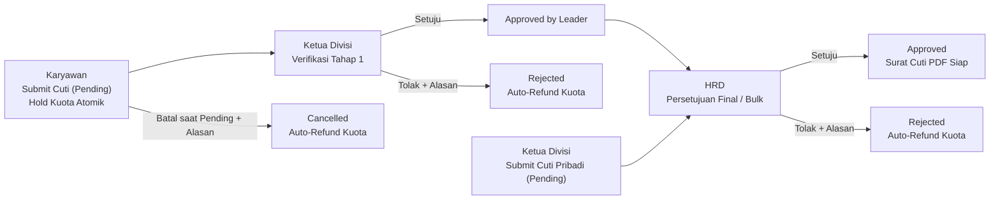

<div align="center">
  
  <h1>OTIUM</h1>
  <p><strong>Sistem Manajemen Cuti Karyawan &bull; Ketertiban Waktu &amp; Arsip Cuti</strong></p>

  <p>
    
    
    
    
    
  </p>

  <p>
    <a href="#alur-persetujuan--siklus-kuota">Alur Persetujuan</a> &bull;
    <a href="#matriks-fitur--hak-akses-rbac">Matriks RBAC</a> &bull;
    <a href="#arsitektur--keamanan-database">Arsitektur</a> &bull;
    <a href="#instalasi-cepat">Instalasi</a> &bull;
    <a href="#akun-demo">Akun Demo</a>
  </p>
</div>

---

## Tentang Proyek

**Otium** *(Lat. ōtium — waktu rehat yang teratur)* adalah aplikasi web *full-stack* untuk mendigitalisasi dan mengotomatisasi siklus pengajuan cuti karyawan, verifikasi berjenjang, manajemen kuota presisi `0.5` hari kerja, serah terima tugas (*handover*), hingga penerbitan **Surat Persetujuan Cuti Resmi siap cetak A4/PDF**.

Dibangun sebagai **Individual Project 7 — Tugas Final Praktikum Pemrograman Web 2026**, proyek ini mematuhi arsitektur **100% JavaScript Murni** (tanpa TypeScript) dan **100% PostgreSQL Raw SQL** melalui `pg` (*zero ORM*), dibalut dalam antarmuka **Swiss Archival / Editorial Ledger** yang mendukung **Light & Dark Mode** secara penuh.

---

## Sorotan Utama

| Pilar | Implementasi |
| :--- | :--- |
| **Autentikasi & RBAC 2 Lapis** | Login tunggal via `Email` atau `Username` + `Password` (`bcryptjs`), deteksi role otomatis, opsi **Remember Me** (JWT HttpOnly Cookie `1 hari` / `7 hari`), Edge `middleware.js`, pemblokiran akun nonaktif, dan tanpa registrasi publik. |
| **Kalkulasi Kuota Presisi `0.5` Hari** | Kuota tahunan `12.0` hari kerja/tahun, otomatis mengecualikan **Sabtu–Minggu** dan **hari libur nasional** (`holidays`), mendukung cuti setengah hari (`0.5`), dilengkapi **12-Day Quota Precision Ruler** & **What-If Projection**. |
| **Transaksi SQL Atomik & Auto-Refund** | Seluruh mutasi kuota & multi-tabel dibungkus `BEGIN ... COMMIT / ROLLBACK` dengan penguncian baris (`SELECT ... FOR UPDATE`). Kuota otomatis dikembalikan (*auto-refund*) saat pengajuan dibatalkan atau ditolak. |
| **Lembar Edaran Paraf (*Routing Slip*)** | Verifikasi Tahap 1 (**Ketua Divisi**) dan Persetujuan Final (**HRD**) lengkap dengan riwayat paraf, alasan wajib tolak/batal, **Multi-Approve Checkbox** atomik untuk HRD, dan dokumen cetak **Surat Cuti PDF**. |
| **Jenis Cuti Dinamis & CMS Lengkap** | Seluruh kategori cuti (Tahunan, Sakit, Menikah, dll.) dikelola dinamis dari tabel `leave_types`, bersama CRUD User (proteksi anti-hapus `Admin`/`HRD`), Divisi (*Double Confirmation Delete* tanpa hapus anggota), dan Anggota Divisi. |

---

## Alur Persetujuan & Siklus Kuota



---

## Matriks Fitur & Hak Akses (RBAC)

| Modul / Rute | Admin | HRD | Ketua Divisi | Karyawan |
| :--- | :---: | :---: | :---: | :---: |
| **Dashboard Adaptif** (`/dashboard`) | Statistik Master | Antrean & Kapasitas | Kuota & Tim Divisi | Kuota & Riwayat |
| **Ajukan Cuti & What-If** (`/leaves/new`) | — | — | Ya *(langsung ke HRD)* | Ya *(via Ketua Divisi)* |
| **Riwayat, Batal, & Surat PDF** (`/leaves`) | — | — | Ya *(milik sendiri)* | Ya *(milik sendiri)* |
| **Verifikasi Tahap 1** (`/approvals/leader`) | — | — | Ya *(divisi sendiri)* | — |
| **Persetujuan Final & Bulk** (`/approvals/hrd`) | — | Ya *(+ Cetak PDF)* | — | — |
| **Manajemen Pengguna** (`/admin/users`) | Ya *(proteksi Admin/HRD)* | — | — | — |
| **Manajemen Divisi** (`/admin/divisions`) | Ya *(2x konfirmasi hapus)* | — | — | — |
| **Anggota Divisi** (`/admin/division-members`) | Ya *(lepas tanpa hapus akun)* | — | — | — |
| **Jenis Cuti Dinamis** (`/admin/leave-types`) | Ya | — | — | — |
| **Profil, Avatar, & Password** (`/profile`) | Ya *(full edit)* | Ya | Ya *(+ Precision Ruler)* | Ya *(+ Precision Ruler)* |

---

## Arsitektur & Keamanan Database

- **Zero ORM / Pure Raw SQL:** Seluruh query dieksekusi menggunakan `pg` (`Pool`) dengan *parameterized queries* (`$1, $2, ...`) untuk mencegah *SQL Injection*.
- **7 Tabel Relasional PostgreSQL:**
  `divisions` &bull; `users` &bull; `leave_types` &bull; `leave_requests` &bull; `leave_approvals` &bull; `notifications` &bull; `holidays`
- **Validasi Berlapis:** Validasi UX sisi klien pada form `.jsx` + validasi keamanan sisi server pada **Next.js Server Actions** (`src/actions/*.js`) dan **Route Handlers** (`src/app/api/**/route.js`).
- **Penyimpanan Lokal Aman:** Unggahan lampiran surat dokter (`/public/uploads/attachments`) dan avatar (`/public/uploads/avatars`) divalidasi tipe & ukurannya di sisi server.

### Struktur Direktori

```text
otium/
├── database/
│   ├── database.sql           # Skrip gabungan DDL + Seed Data (1x impor pgAdmin)
│   ├── schema.sql             # DDL 7 tabel, constraint, & indeks performa
│   └── seed.sql               # Data awal 4 role, divisi, & 3 jenis cuti inti
├── public/
│   ├── images/                # Logo Otium (Swiss Ledger Seal)
│   └── uploads/               # Direktori penyimpanan lampiran & avatar lokal
├── src/
│   ├── middleware.js          # Edge Auth Guard & RBAC Route Protection
│   ├── app/
│   │   ├── (auth)/login/      # Halaman Login terpusat + switch mode tema
│   │   ├── (dashboard)/       # Workspace terproteksi (dashboard, leaves, approvals, admin, profile)
│   │   └── api/               # Route Handlers (auth, leaves, pdf, approvals, admin, upload, notifications)
│   ├── actions/               # Next.js Server Actions ("use server")
│   ├── components/            # Komponen UI modular (auth, layout, ui, dashboard, leaves, approvals, admin, profile)
│   └── lib/                   # Pool 'pg', withTransaction, JWT/auth, validator, utilitas tanggal
├── .env.example               # Template variabel lingkungan
├── jsconfig.json              # Alias path JavaScript (@/* -> ./src/*)
└── tailwind.config.js         # Token desain Swiss Archival
```

---

## Instalasi Cepat

### Prasyarat
- **Node.js** `>= 18.18` (disarankan Node.js 20 LTS)
- **PostgreSQL** `>= 14` & **pgAdmin 4** (atau `psql`)

### Langkah Setup

#### Cara 1 — Setup Otomatis (Direkomendasikan)
```bash
git clone https://github.com/MochPutraFS/Otium.git
cd Otium
npm install
npm run setup
npm run dev
```
Perintah `npm run setup` ([scripts/setup.js](./scripts/setup.js)) akan memandu Anda mengisi kredensial PostgreSQL, membuat file `.env` lengkap dengan `JWT_SECRET` acak, membuat database jika belum ada, mengimpor `database/database.sql`, dan menyiapkan folder `public/uploads/`.

#### Cara 2 — Setup Manual (via pgAdmin)
1. Clone repositori dan jalankan `npm install`.
2. Buat database baru di PostgreSQL / pgAdmin (misalnya `otium_db`), lalu impor **`database/database.sql`** satu kali (atau `database/schema.sql` diikuti `database/seed.sql`).
3. Salin `.env.example` menjadi `.env` lalu sesuaikan `DATABASE_URL` dan `JWT_SECRET`.
4. Jalankan `npm run dev` dan buka **[http://localhost:3000/login](http://localhost:3000/login)**.

---

## Akun Demo

Seluruh akun awal dari `database/database.sql` / `database/seed.sql` menggunakan kata sandi default: **`password123`**

| Role | Username | Email | Divisi | Keterangan |
| :--- | :--- | :--- | :--- | :--- |
| **Admin** | `admin` | `admin@perusahaan.com` | — | Akses penuh CMS Modul 1–4 |
| **HRD** | `hrd` | `hrd@perusahaan.com` | — | Persetujuan final, *bulk approve*, & cetak PDF |
| **Ketua Divisi** | `leader.eng` | `ketua.eng@perusahaan.com` | Engineering | Verifikasi Tahap 1 divisi & ajukan cuti ke HRD |
| **Karyawan 1** | `karyawan1` | `andi.pratama@perusahaan.com` | Engineering | Pemohon cuti / rekan *handover* |
| **Karyawan 2** | `karyawan2` | `dewi.lestari@perusahaan.com` | Engineering | Pemohon cuti / rekan *handover* |

---

## Lisensi

Proyek ini dirilis di bawah lisensi [MIT](./LICENSE).
